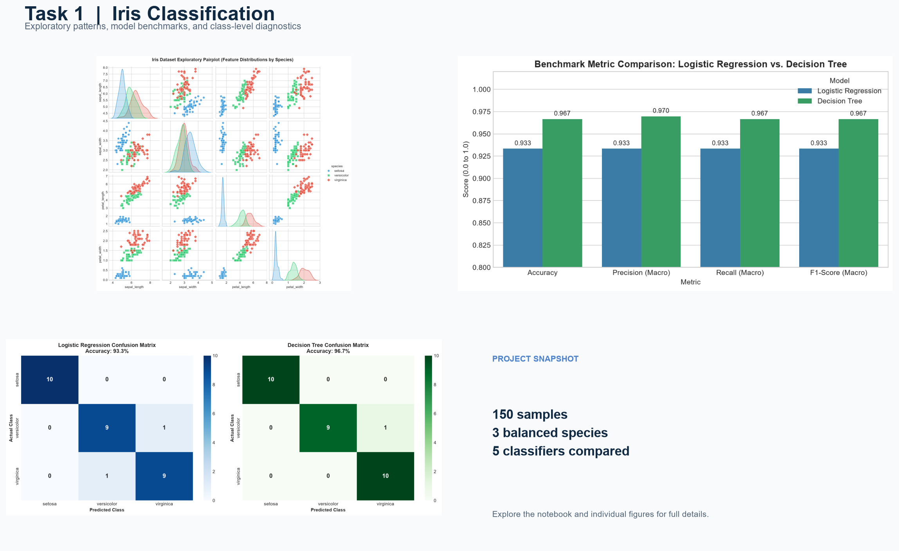
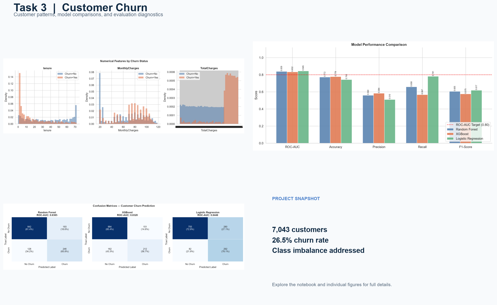
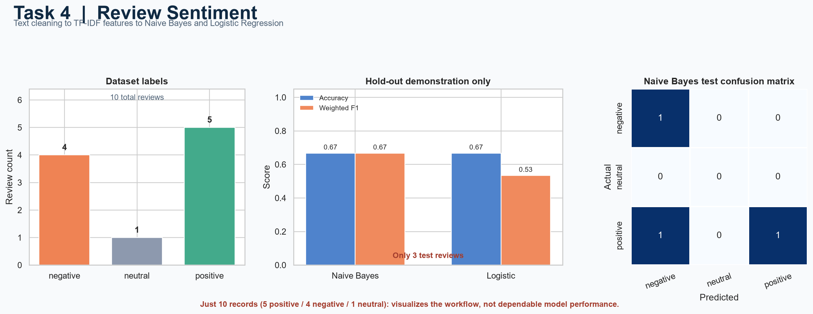

# Datheon Machine Learning & Data Science Internship

Portfolio of four predictive modeling projects completed for the Datheon Machine Learning & Data Science Internship task pack. Each task directory includes its notebook, project documentation, and supporting data or visualizations.

## Projects

| Task | Project | Methods |
| --- | --- | --- |
| 1 | [Multi-Class Classification](task-1-multiclass-classification/) | Iris classification, feature scaling, model benchmarking, and confusion-matrix visualizations |
| 2 | [California Housing Price Prediction](task-2-california-housing-price-prediction/) | Housing price regression, feature engineering, and regression model evaluation |
| 3 | [Customer Churn Classification](task-3-customer-churn-classification/) | Telco churn prediction with preprocessing, SMOTE, Random Forest, XGBoost, and ROC-AUC evaluation |
| 4 | [NLP Sentiment Classification](task-4-nlp-sentiment-classification/) | Review text cleaning, TF-IDF features, Naive Bayes, Logistic Regression, and interactive sentiment prediction |

### Project previews

| Task 1 | Task 2 |
| --- | --- |
| [](task-1-multiclass-classification/) | [](task-2-california-housing-price-prediction/) |

| Task 3 | Task 4 |
| --- | --- |
| [](task-3-customer-churn-classification/) | [](task-4-nlp-sentiment-classification/) |

## Repository Structure

```text
├── task-1-multiclass-classification/
│   ├── figures/
│   ├── screenshots/
│   ├── iris_classification_pipeline.ipynb
│   └── README.md
├── task-2-california-housing-price-prediction/
│   ├── screenshots/
│   ├── housing_price_prediction.ipynb
│   └── README.md
├── task-3-customer-churn-classification/
│   ├── figures/
│   ├── screenshots/
│   ├── customer_churn_classifier.ipynb
│   └── README.md
└── task-4-nlp-sentiment-classification/
    ├── data/
    │   ├── README.md
    │   └── sentiment_reviews.csv
    ├── notebooks/
    │   └── sentiment_classification.ipynb
    ├── screenshots/
    ├── src/
    │   └── sentiment_classifier.py
    ├── requirements.txt
    └── README.md
```

## Getting Started

Each project is self-contained. See its README for project-specific setup, dataset details, and instructions. Where a `requirements.txt` is provided:

```bash
python -m pip install -r requirements.txt
```

Open the project's Jupyter notebook to explore the data, run the modeling pipeline, and review its visualizations.

## Tools

Python, Jupyter Notebook, Pandas, NumPy, Matplotlib, Seaborn, and Scikit-Learn. The churn project also uses XGBoost and imbalanced-learn; the sentiment project uses NLTK and TF-IDF.
